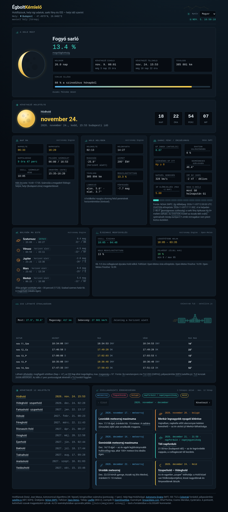

# ÉgboltKémlelő (SkySeeker)

Statikus égi naptár: következő holdtöltek, helyi Nap/Hold/bolygó adatok, sarki fény (NOAA SWPC) és látható ISS-áthaladások — a böngészőben, a választott helyre (alapértelmezés: Budapest).

**English:** [README.md](./README.md)

**Élő demo:** https://wroadd.github.io/skyseeker/



## Funkciók

- Következő holdtölte visszaszámláló + hagyományos holdnevek (szójegyzék-buborékokkal)
- Helyi napkelte/-nyugta, szürkület, holdkelte/-nyugta, bolygók este
- Éjszakai megfigyelési ablak + Open-Meteo felhőzet
- Sarki fény / űridőjárás (Kp, OVATION, napszél) geomágneses szélességgel
- Látható ISS-áthaladások (Celestrak TLE + satellite.js SGP4)
- Térképes helyválasztó (Leaflet + OSM + Nominatim)
- **Nyelvek:** magyar, angol, német (`i18n.js`); választó a fejlécben
- Csillagászati események (2 hónapos lapozó, fordítható szövegek)
- **Eredeti vonalrajz illusztrációk** (ISS, bolygók, eseménykategóriák, kártyafejek, finom csillagkép a fejlécben) — beágyazott SVG sprite, MIT, nincs külső képhivatkozás

## Nyelv választása

1. Mentett választás a `localStorage`-ban (`holdnaptar.lang.v1`)
2. Egyébként javaslat a reverse geocode `country_code` alapján (HU→hu, DE/AT/LI→de, GB/US/…→en) vagy `navigator.language`
3. Egyébként magyar (`hu`)

Ha a **hely** más nyelvet javasol, mint az aktuális, kis elutasítható ajánlat jelenik meg (pl. „Switch to English?”); az elutasítás megjegyződik. A dátumok `Intl`-lel, a `<html lang>` frissül. Wikipédia: ha van ellenőrzött cikk az adott nyelven, az; különben angol jelöléssel.

## Adatforrások

Lásd a táblázatot az [angol README](./README.md)-ben (NOAA SWPC, Open-Meteo, Celestrak, OSM/Nominatim, Astronomy Engine, satellite.js, Leaflet). Licencszövegek: `vendor/*-LICENSE.txt`. Projekt: [MIT](./LICENSE) © Peter Zsak.

## Futtatás helyben

```bash
npx --yes serve -l 4173 .
```

Nyisd meg: http://localhost:4173/

## Fork és GitHub Pages

1. Forkold a repót
2. Settings → Pages → branch: `main`, mappa: `/ (root)`
3. A site: `https://<felhasználó>.github.io/skyseeker/`

## Esemény / szójegyzék / fordítás

### Havi rutin — új esemény

1. `i18n.js` → `const EV_I18N = [`
2. Új sor:

```js
["YYYY-MM-DDTHH:MMZ", "m",
  {hu:"…", en:"…", de:"…"},
  {hu:"…", en:"…", de:"…"}],
```

Kategóriák: `m` meteorraj · `e` fogyatkozás · `p` bolygó · `s` évszak · `l` Hold.

3. Hiányzó fordítás: **aktuális → en → hu**. Az angol legyen kitöltve.
4. Ellenőrzés helyben + lapozó.

Részletek (szójegyzék, UI, új nyelv): [README.md](./README.md).

## Pontosság

A holdtölték Meeus szerint (~1 perc). Kelte/nyugta a refrakciótól és a koordinátáktól függ. Az ISS a TLE korától (±~1 perc). A sarki fény becslés; közép-európai észleléshez erős vihar kell. Nem helyettesít szakmai efemeridát.

## Licenc

[MIT](./LICENSE) — Copyright (c) 2026 Peter Zsak. Harmadik felek licencei a `vendor/` alatt.
