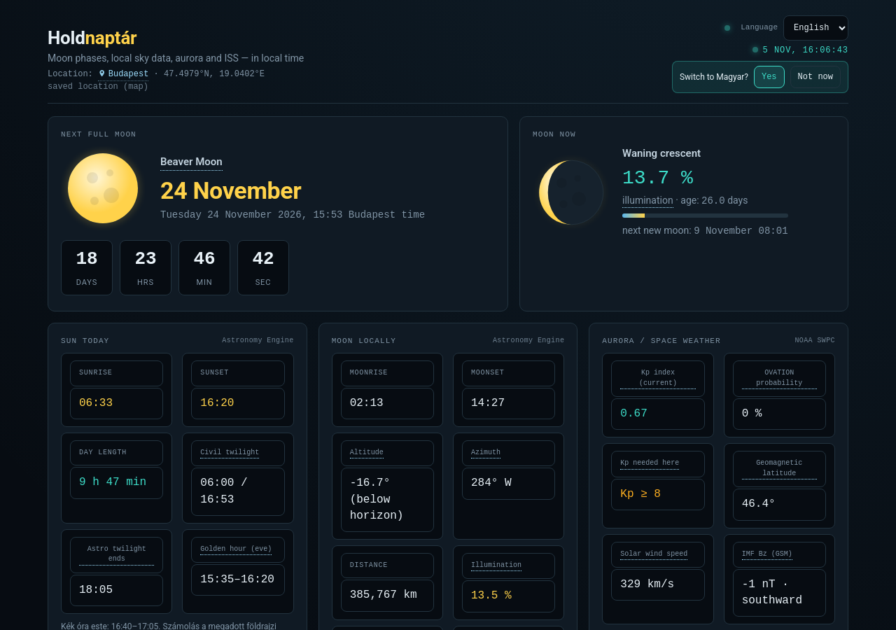

# Holdnaptár (Moon Calendar)

Static sky calendar for the next full moons, local Sun/Moon/planet data, aurora (NOAA SWPC), and visible ISS passes — computed in the browser for a chosen location (default Budapest).

**Magyar leírás:** [README.hu.md](./README.hu.md)

**Live demo:** https://wroadd.github.io/holdnaptar/



## Features

- Next full moon countdown + traditional moon names (with glossary popovers)
- Local sunrise/set, twilight, moonrise/set, planets after dusk
- Night observing window + Open-Meteo cloud cover
- Aurora / space weather (Kp, OVATION, solar wind) with geomagnetic latitude hint
- Visible ISS passes (Celestrak TLE + satellite.js SGP4)
- Map location picker (Leaflet + OSM tiles + Nominatim search/reverse)
- **i18n:** Hungarian, English, German (`i18n.js`); language selector in the header
- Astronomical events list (2-month pager, editable translations)

## Language behaviour

1. Saved choice in `localStorage` (`holdnaptar.lang.v1`)
2. Else suggestion from reverse-geocode `country_code` (HU→hu, DE/AT/LI→de, GB/US/…→en) or `navigator.language`
3. Else Hungarian (`hu`)

If the **location** suggests a language different from the current one, a small dismissible offer appears (e.g. “Switch to English?”); dismissal is remembered. Dates use `Intl` for the selected locale; `<html lang>` is updated. Wikipedia links prefer the UI language when a verified article exists, otherwise English with a marker.

## Data sources & policies

| Source | Use | Notes |
|--------|-----|--------|
| [NOAA SWPC](https://www.swpc.noaa.gov/) | Kp, OVATION, solar wind, scales | Public data; cite NOAA SWPC |
| [Open-Meteo](https://open-meteo.com/) | Hourly cloud cover | Free non-commercial API; attribution appreciated |
| [Celestrak](https://celestrak.org/) | ISS TLE | Follow Celestrak redistribution terms |
| [OSM / Nominatim](https://operations.osmfoundation.org/policies/nominatim/) | Geocoding | ≤1 req/s; valid User-Agent implied by browser; no heavy bulk use |
| OSM tiles | Map background | [Tile usage policy](https://operations.osmfoundation.org/policies/tiles/); attribution required (shown on map) |
| [Astronomy Engine](https://github.com/cosinekitty/astronomy) | Ephemerides | MIT — vendored |
| [satellite.js](https://github.com/shashwatak/satellite-js) | SGP4 | MIT — vendored |
| [Leaflet](https://leafletjs.com/) | Map UI | BSD-2-Clause — vendored |

Vendored license texts: `vendor/*-LICENSE.txt`. Project license: [MIT](./LICENSE) © Peter Zsak.

## Project structure

```
index.html      # UI + app logic
i18n.js         # UI / glossary / moon names / events (hu, en, de)
vendor/         # astronomy, satellite.js, leaflet (+ licenses)
docs/           # screenshots
LICENSE         # MIT
README.md       # English
README.hu.md    # Hungarian
```

## Run locally

Any static server from the repo root:

```bash
npx --yes serve -l 4173 .
# or: python3 -m http.server 4173
```

Open http://localhost:4173/

## Fork & GitHub Pages

1. Fork https://github.com/wroadd/holdnaptar
2. Settings → Pages → Source: **Deploy from a branch** → `main` / `/ (root)`
3. Wait for the Pages build; site will be at `https://<user>.github.io/holdnaptar/`

## Add events / glossary / translations

### Events (monthly maintenance)

1. Open `i18n.js`, find `const EV_I18N = [`.
2. Append a row (UTC time, category, title, description):

```js
["YYYY-MM-DDTHH:MMZ", "m",
  {hu:"…", en:"…", de:"…"},
  {hu:"…", en:"…", de:"…"}],
```

Categories: `m` meteor shower · `e` eclipse · `p` planet · `s` season · `l` Moon.

3. Missing translations fall back **current → en → hu** (`tt` / `evStr`). Keep English filled in.
4. Reload locally and check the events pager.

### Glossary terms

Add an entry under `GLOSSARY_I18N` with `title`/`text` per language (optional `wiki: {hu|en|de: {url,lang,label}}`), and aliases in `GLOSSARY_ALIASES`.

### UI strings

Edit `UI.hu` / `UI.en` / `UI.de` in `i18n.js`. Mark static HTML with `data-i18n="key"` where needed.

### New language

Extend `LANG_META`, `UI`, `GLOSSARY_I18N`, `MOON_I18N`, `EV_I18N`, and `COUNTRY_LANG`. Prefer quality over count.

## Accuracy caveats

- Full-moon list: Jean Meeus algorithms (~1 minute).
- Rise/set and twilight depend on refraction and the selected coordinates.
- ISS times depend on TLE age (±~1 minute typical).
- Aurora guidance is approximate; mid-latitude sightings need strong storms.
- Not a substitute for professional ephemerides or observing alerts.

## Contributing

Issues and PRs welcome. Keep the site static (no build step required). Match existing code style; add Playwright coverage for UI changes when practical. Do not commit secrets. Respect third-party API rate limits and attribution.

## License

[MIT](./LICENSE) — Copyright (c) 2026 Peter Zsak. Third-party licenses remain under `vendor/`.
